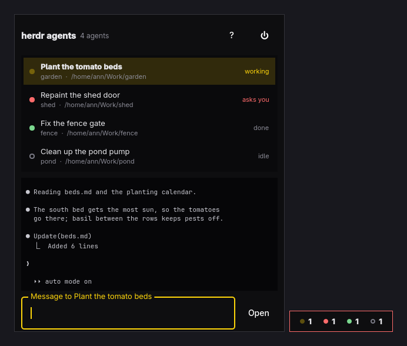

# Drover

A floating indicator of your [herdr](https://herdr.dev) agents, on every
Omarchy workspace. The pill counts the agents that are working, asking you
something, done, and idle; drag it wherever you like, and it stays there.
Click it and a large panel opens beside it, like a chat: every agent of the
local herdr session on the left, the selected agent's screen on the right, and
a box to message it, or keys to answer its question, without leaving the
workspace you're on.



## Use

Start **Drover** from the app launcher (`Super + Space`). Starting it again
opens or hides the panel of the one that is already running.

```sh
drover            # start with the panel closed (autostart), or open/hide it
drover toggle     # open or hide the panel, starting drover if needed
drover open       # open the panel, starting drover if needed
drover pick       # open the panel with the workspace picker
drover quit       # stop it
```

A global shortcut is one line in `~/.config/hypr/bindings.lua`:

```lua
o.bind("SUPER + H", "Herdr agents", "drover toggle")
```

| Key / action        | Does                                                       |
| ------------------- | ---------------------------------------------------------- |
| Click the pill      | Show or hide the panel                                     |
| Drag the pill       | Move it; the panel opens on the side with room             |
| `Enter`             | Send the message; with an empty box, open the agent        |
| `Shift+Enter`       | New line in the message                                    |
| `Alt+↑` `Alt+↓`     | Pick an agent                                              |
| `Ctrl+P`            | Pick a workspace and start the default agent there         |
| `Ctrl+O`            | Open the agent in herdr (or double-click its row)          |
| `Tab`               | Move to the answer keys when an agent asks you something   |
| `1`–`9` `↑` `↓` `Enter` | Answer, while the answer keys have the keyboard        |
| `Shift+Esc`         | Send Esc to the agent                                      |
| `Esc`               | Close the picker or help, then hide the panel              |
| `F1`                | Show or hide the shortcuts                                 |
| `Ctrl+Q`            | Quit                                                       |

When an agent starts asking something while you type, the keyboard doesn't
follow it: no key you meant for the message box answers the agent. Answer
with the keycaps, or press `Tab` to answer from the keyboard.

The agent's screen keeps the terminal's colors and lines. Scroll up or select
text and it holds still; "New output ↓" brings it back to the newest lines.

Opening an agent focuses it in herdr (`herdr agent focus`) and brings the
herdr window forward, wherever it is.

### The default agent

`Ctrl+P` opens a new tab in the chosen workspace, in the folder it already
works in, and starts the agent kind set in `~/.config/drover/config`
(`claude` when there is none):

```ini
agent = codex
```

Hyprland setups that bind `Ctrl+P` globally swallow the key before drover
sees it, since a layer surface with the keyboard is never Hyprland's active
window. Such a binding can hand the key on while drover's panel has the
keyboard, which drover marks with `$XDG_RUNTIME_DIR/drover.focus`:

```lua
local focus = io.open((os.getenv("XDG_RUNTIME_DIR") or "") .. "/drover.focus")
if focus then focus:close(); hl.exec_cmd("drover pick") return end
```

## How it works

Drover is a transparent wlr-layer-shell surface (via `layer-shell-qt`) on the
top layer, over the whole area the bar leaves free, so it floats over windows
on every workspace without window rules and hides under fullscreen windows.
Only the pill and the open panel take the pointer; everything else clicks
through. It takes keyboard focus only while the panel is open. The pill's
place is kept in `~/.local/state/drover/position`.

It polls `herdr agent list` and `herdr workspace list` once a second (a few
milliseconds each) and reads the selected agent's screen with `herdr agent
read --format ansi` while the panel is open: its scrollback while it is idle,
its visible screen while it works (herdr can't scroll a busy agent's history).
A failed poll keeps the last list and says it is out of date; if the selected
agent's pane closes, nothing is selected until you pick another, so a draft
never goes to an agent you didn't choose. Only the local herdr session is shown; saved
SSH machines (`herdr --machine`) take seconds per call and are left out.

It looks like the Omarchy shell: the theme's colors from `colors.toml`, the
Hyprland active border (`hyprland_active_border`) around the panel and pill,
Hyprland's window rounding, and your terminal's font and size (read from the
config of the first terminal in `~/.config/xdg-terminals.list`: Ghostty,
Alacritty, kitty, or foot), so it reads like the terminal the agents run in. It follows theme
switches and the language picked under Setup > Language (English and Czech so
far) live.

To start it at login, add to `~/.config/hypr/autostart.lua`:

```lua
o.launch_on_start("drover")
```

## Build

```sh
bin/build      # build/drover
bin/test       # Qt Test, offscreen: the backend, and the real QML driven against a fake herdr
bin/install    # makepkg -fsi: installs the binary, launcher entry, and icon
```

Needs `qt6-base`, `qt6-declarative`, `qt6-wayland`, `layer-shell-qt`, and
`herdr`.

## License

MIT, see [LICENSE](LICENSE).
