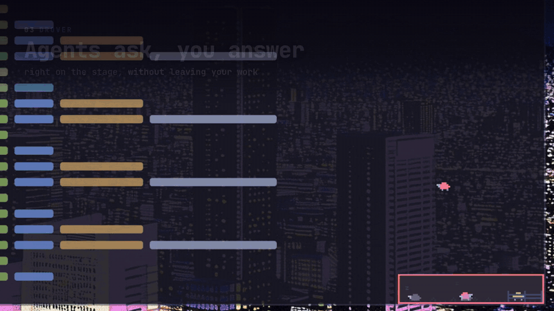

<div align="center">

# 🐑 Drover

**Your herd of AI agents, always in sight.**

A tiny live herd of your [herdr](https://herdr.dev) agents, floating on every
[Omarchy](https://omarchy.org) workspace. You see who's working, who's done and
who needs you, and you answer them without leaving what you're doing.

[](https://github.com/petrzpav/drover/releases/latest) [](LICENSE) [](https://omarchy.org) [](https://herdr.dev)



</div>

## Why Drover

- **Always on top, on every workspace.** Each agent is a pixel sheep. Working
  sheep wander, a finished one jumps into the pen, and the one asking stands
  under a blinking `?`.
- **Answer questions where you are.** Claude's questions and permission prompts
  land on a small stage beside the herd. Press `1`–`9` and the agent carries on.
- **A real terminal, one click away.** Click the herd and the agent's herdr pane
  opens in a panel: Shift+Tab, Esc, Ctrl+C, menus and colors work as they do in
  herdr. `Alt+↑` `Alt+↓` switch agents instantly.
- **An editor beside every agent.** `Alt+E` opens [Fresh](https://github.com/sinelaw/fresh)
  in the agent's folder, and `Ctrl+;` opens a shell below it.
- **New agents in a keystroke.** `Ctrl+P` picks or creates a workspace and
  starts your default agent there.
- **Feels like part of Omarchy.** It uses the theme's colors, border and
  rounding and your terminal's font, and it follows theme switches live, Fresh
  included.

## Install

```sh
sudo pacman -U https://github.com/petrzpav/drover/releases/download/v0.6.0/drover-0.6.0-1-x86_64.pkg.tar.zst
```

It needs `herdr`; `fresh-editor` (AUR) adds the editor. To build from source,
run `git clone https://github.com/petrzpav/drover && cd drover && bin/install`.

Then start it at login, give it a key, and let Claude ask on its stage:

```lua
-- ~/.config/hypr/autostart.lua
o.launch_on_start("drover")
-- ~/.config/hypr/bindings.lua
o.bind("SUPER + H", "Herdr agents", "drover toggle")
```

```sh
drover hooks install    # Claude's questions on drover's stage
```

```ini
# ~/.config/drover/config — the sheep (the default is bars)
indicator = sheep
```

## The herd

| `indicator` | Looks like | Shows |
| ----------- | ---------- | ----- |
| `sheep` |  | A sheep per agent in its state's color: working sheep wander, done ones run into the pen to graze, the asking one stands under a blinking question mark, idle ones sleep. |
| `bars` |  | A bar per agent: working bars bounce, a finished bar shoots up and settles green, an asking one blinks red. |
| `dots` |  | How many agents are working, asking, done and idle. |

The border flashes green when an agent finishes. It flashes red when one asks,
and stays red while anyone is waiting for you. Drag the herd anywhere you like
and it stays there.

## Questions on the stage


When a Claude agent asks something, its sheep jumps the fence onto a card
beside the herd. Pick an option with `1`–`9`, or take the last row for your own
words. Permission prompts offer yes, yes and don't ask again, no, or no with
what to do instead. If an agent ends its turn with a plain question ("Shall I
push it?"), that comes on stage too, and drover types your answer into its
terminal.

The stage never steals the keyboard. Click it or press `Super+H` to answer;
`Esc` leaves the question to the agent's terminal.

<details>
<summary>How the stage hooks work</summary>

`drover hooks install` (or `uninstall`, `status`) adds three Claude Code hooks
to `~/.claude/settings.json` and leaves the rest of the file as it was. A copy of
the old file is kept as `settings.json.drover-backup`. Agents started afterwards
ask on the stage; restart running ones, or review the change under `/hooks` in
them.

The hook (`drover hook`) passes the question to drover over a local socket and
waits for your answer. When drover has nothing to do with the question, the hook
prints nothing and Claude shows its own dialog as before. That happens when:

- drover isn't running;
- the session isn't an agent in herdr (scripts, `claude -p`);
- you are already looking at that agent;
- the options carry previews.

While drover holds a question, the herdr window shows the agent as working.
After `ask_hold` seconds without an answer, the question goes back to the
terminal. A permission prompt shows in the terminal at the same time, and you
can answer it in either place.

</details>

## The panel


Every agent of the local herdr session is on the left. On the right is a real
terminal attached to the selected agent (`herdr terminal attach`), drawn by
drover itself on libvterm with no output buffering. The pane takes the panel's
size while it's open and gets herdr's size back when you close it.

| Key | Does |
| --- | ---- |
| `Super+H` | Show or hide the panel; with a question on stage, give it the keyboard |
| `Alt+↑` `Alt+↓` | Pick an agent |
| `Alt+E` | Switch between the agent and its editor |
| `Ctrl+;` (editor) | Show or hide a shell below the editor |
| `Ctrl+P` | Pick a workspace and start an agent; `Ctrl+O` picks a new folder, `Ctrl+D` twice closes one |
| `Ctrl+Shift+O` | Open the agent in herdr |
| `Shift`+drag, `Ctrl+Shift+C` `V` | Select, copy, paste |
| `F1` | All shortcuts |

Any other key goes to the agent, as in herdr. Mouse wheel and clicks go to
herdr too, which scrolls the agent's history.

## Configuration

`~/.config/drover/config`, read at start:

```ini
# sheep, bars (the default) or dots
indicator = sheep
# what Ctrl+P starts: claude (the default), codex, …
agent = claude
# the editor beside an agent: fresh (the default), micro, …
editor = fresh
# how the sheep comes on stage: fence (the default) or spotlight
stage = fence
# end-of-turn questions on the stage too: yes (the default) or no
ask_replies = yes
# seconds before an unanswered question goes back to the terminal; 0 waits for good
ask_hold = 180
# close workspaces with a herdr plugin's action instead of herdr workspace close
# close_action = petrzpav.persistent-spaces.delete
```

```sh
drover               # start (autostart), or open/hide the running one
drover toggle|open   # open or hide the panel, starting drover if needed
drover pick          # open the panel with the workspace picker
drover quit
```

<details>
<summary>Workspace picker details</summary>

`Ctrl+P` opens a new tab in the chosen workspace, in the folder it already works
in, and starts the default agent. A name no workspace has yet adds a
**Create** row. Enter opens the desktop's folder picker (the xdg portal), unless
the text is already a folder under your home (`~/Work/orchard`). A folder that
doesn't exist yet, inside one that does, shows **new folder** and is made first.
`Ctrl+D`, or the trash button, marks a workspace; a second press runs
`herdr workspace close`, or the plugin action set as `close_action`.

Hyprland bindings that take `Ctrl+P` globally can pass it on while drover's
panel has the keyboard, which drover marks with `$XDG_RUNTIME_DIR/drover.focus`:

```lua
local focus = io.open((os.getenv("XDG_RUNTIME_DIR") or "") .. "/drover.focus")
if focus then focus:close(); hl.exec_cmd("drover pick") return end
```

</details>

<details>
<summary>How it works</summary>

Drover is a transparent wlr-layer-shell surface (`layer-shell-qt`) on the top
layer, so it floats over windows on every workspace without window rules and
hides under fullscreen windows. Only the herd and the open panel take the
pointer; everything else clicks through. It takes the keyboard only while the
panel is open, or the stage once you give it the keyboard.

It lists agents whenever herdr's socket reports a change, so the herd follows
within milliseconds. It also polls, every 5 s while events flow and once a
second otherwise. Only the local herdr session is shown, because saved SSH
machines take seconds per call.

The look comes from Omarchy: the theme's `colors.toml`, the Hyprland active
border, Hyprland's rounding, and the font and size of your terminal (Ghostty,
Alacritty, kitty or foot). Theme switches and the language (English, Czech)
apply live. drover also writes a Fresh theme from the Omarchy colors to
`~/.config/fresh/themes/omarchy.json`; use it with `{ "theme": "omarchy.json" }`
in Fresh's `config.json`.

</details>

## Build

```sh
bin/build        # build/drover
bin/test         # Qt Test, offscreen: the backend, and the real QML against a fake herdr
bin/install      # makepkg -fsi: binary, launcher entry, icon
bin/screenshots  # redraws docs/ against a made-up herd (needs ffmpeg)
```

Needs `qt6-base`, `qt6-declarative`, `qt6-wayland`, `layer-shell-qt`, `libvterm`
and `herdr`.

## License

MIT, see [LICENSE](LICENSE).
