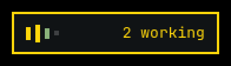
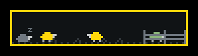
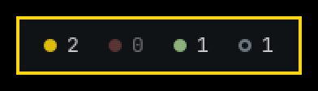
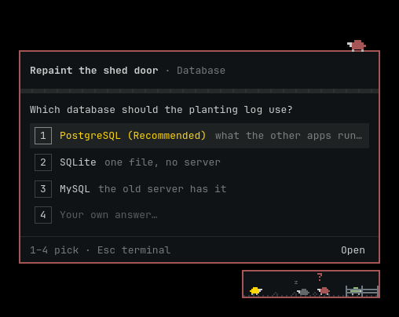

# Drover

A floating indicator of your [herdr](https://herdr.dev) agents, on every
Omarchy workspace. The pill is a small live herd that shows what every agent
is doing and lights up when one finishes or asks you something, and an agent's
question comes on a small stage beside it, to be answered right there; drag it
wherever you like, and it stays there. Click it and a large panel opens beside it: every agent of the local herdr
session on the left, and on the right a real terminal attached to the selected
agent, where you work with it exactly as in herdr (Shift+Tab, Esc, Ctrl+C, its
menus and colors), without leaving the workspace you're on.


### The pill

Three looks, set in `~/.config/drover/config` (bars when there is none);
drover reads it when it starts:

```ini
indicator = sheep
```

| `indicator` | Looks like | Shows |
| ----------- | ---------- | ----- |
| `bars` |  | A bar per agent: working bars bounce, a bar that finishes shoots up and settles green, one that asks you blinks red, idle ones lie low. Beside them the state that matters most: how many ask you, else work, else are done. |
| `sheep` |  | A pixel sheep per agent, in its state's color: working sheep wander the pasture, one that finishes runs and jumps into the pen to graze, one that asks you stands under a blinking question mark, idle ones sleep. |
| `dots` |  | How many agents work, ask you, are done, and are idle. |

When an agent finishes, the pill's border flashes green (bars and sheep); when
one asks you, it flashes red and stays red while anyone waits for you.

## Use

Start **Drover** from the app launcher (`Super + Space`). Starting it again
opens or hides the panel of the one that is already running.

```sh
drover            # start with the panel closed (autostart), or open/hide it
drover toggle     # open or hide the panel, starting drover if needed
drover open       # open the panel, starting drover if needed
drover pick       # open the panel with the workspace picker
drover quit       # stop it
drover hooks install  # agents' questions on drover's stage (see below)
```

A global shortcut is one line in `~/.config/hypr/bindings.lua`:

```lua
o.bind("SUPER + H", "Herdr agents", "drover toggle")
```

| Key / action        | Does                                                       |
| ------------------- | ---------------------------------------------------------- |
| Click the pill      | Show or hide the panel                                     |
| Drag the pill       | Move it; the panel opens on the side with room             |
| Any key             | Goes to the agent's terminal, as in herdr                  |
| Wheel, clicks       | Go to herdr, which scrolls the agent's history         |
| `Shift`+drag        | Select text                                                |
| `Ctrl+Shift+C` `Ctrl+Shift+V` | Copy the selection, paste (bracketed)            |
| `Alt+↑` `Alt+↓`     | Pick an agent                                              |
| `Alt+E`             | Switch between the agent and the editor beside it          |
| `Ctrl+;` (editor)   | Show or hide a terminal below the editor; `Ctrl+W` in it closes it |
| `Ctrl+P`            | Pick a workspace and start the default agent there         |
| `Ctrl+O` (picker)   | Pick the folder for a new workspace                        |
| `Ctrl+D` (picker)   | Close the highlighted workspace; press again to confirm    |
| `Ctrl+Shift+O`      | Open the agent in herdr (or double-click its row)          |
| `Super+H`           | Show or hide the panel (with the binding below); while an agent asks on the stage, give it the keyboard or take it back |
| `1`–`9`, Enter (stage) | Answer the agent's question                             |
| `Esc` (stage)       | Leave the question to the agent's terminal                 |
| `Esc`               | Close the picker or help; outside the terminal, hide the panel |
| `F1`                | Show or hide the shortcuts                                 |
| `Ctrl+Q`            | Quit                                                       |

The terminal is `herdr terminal attach` on the agent's pane, so it shows and
takes exactly what herdr's own window does. While the panel is open the pane
takes the panel's size; closing the panel detaches, and the pane gets herdr's
size back. Opening an agent focuses it in herdr (`herdr agent focus`) and
brings the herdr window forward, wherever it is.

### The editor beside an agent

`Alt+E` (or **editor** in the panel's header) shows an editor next to the
selected agent, in its folder; `Alt+E` again goes back to the agent. The first
time, drover splits the agent's herdr tab and starts the editor in the new
pane (labelled `editor`), so herdr shows it beside the agent too; after that,
both drover and herdr reuse that pane, and quitting the editor closes it.

The editor is [Fresh](https://github.com/sinelaw/fresh) (`fresh-editor` in
the AUR): keys and mouse as in VS Code, a file explorer, `Ctrl+P` to find
files, LSP. While it is in front, `Ctrl+P` is its own (the desktop's binding
reaches it through drover), and `Ctrl+Shift` shortcuts reach it as such.
`Ctrl+;` in the editor shows a terminal below it, the full width of the
editor's side, in the agent's folder (a herdr pane labelled `shell`);
`Ctrl+;` again hides it and it keeps running, `Ctrl+W` in it closes it.
Switching between the agent, the editor and the terminal is instant: all
stay attached while the panel is open. When the agent ends (it is gone for
three seconds), its editor and terminal close too, and so does its pane if
only a shell is left there; a tab where another agent works keeps them.

Another terminal editor goes in the config:

```ini
editor = micro
```

drover keeps Fresh in the Omarchy theme: it writes a Fresh theme from the
theme's colors to `~/.config/fresh/themes/omarchy.json` and has every running
Fresh apply it whenever the theme changes. Use it in `~/.config/fresh/config.json`:

```json
{ "theme": "omarchy.json" }
```

### Questions on the stage

When a Claude agent asks you something (a question with options, or a
permission prompt), its sheep jumps the pasture's fence and lands on a small
card beside the pill. You can answer there without
opening the panel or the herdr window. Pick an option with `1`–`9` (a
multiple-choice question ticks with digits and sends with Enter), or take
the last row for your own words. A permission prompt offers yes, yes and
don't ask again (whatever Claude proposes, like `Bash(npm test:*)`), no
(the agent stops and waits), or no with what to do instead. Several agents
asking wait in line; the next one peeks in from the wings.



An agent that ends its turn with a plain question ("Shall I push it?")
comes on stage too, with the end of its message: `1` answers yes, the last
row takes your own words, and drover types the answer into the agent's
terminal and presses Enter, as if you had. It types only into the same
Claude session, done or idle, with nothing in its prompt; otherwise it
says why and opens the agent in the panel. `Esc` leaves the question for
later, and an answer typed in the terminal takes it off the stage. If that
is too much, turn it off:

```ini
ask_replies = no
```

The stage never takes the keyboard on its own, so typing elsewhere can't
answer it: click it, or press drover's key (`drover toggle`, `Super+H` with
the binding above). It then keeps the keyboard until you answer; the same
key hands it back and leaves the question waiting. `Esc` leaves the question to the agent's terminal, and
**Open** (`Ctrl+O`) opens the agent in the panel.

It needs three Claude Code hooks in `~/.claude/settings.json`; drover adds or
removes them, leaving the rest of the file as it was (a copy of the old one
is kept beside it, as `settings.json.drover-backup`):

```sh
drover hooks install     # or uninstall, or status
```

Agents started afterwards ask on the stage; restart running ones, or review
the change under `/hooks` in them. The hook (`drover hook`) passes the
question to drover over a local socket and waits for your answer. Whenever
drover has nothing to do with the question, the hook prints nothing and
Claude shows its own dialog as before. That happens when drover isn't
running, the session isn't an agent in herdr (scripts, `claude -p`), you are
already looking at that agent (in the panel, or in the herdr window), or the
options carry previews.

While drover holds a question, Claude's own dialog doesn't show, so the herdr
window and remote clients see the agent working. After `ask_hold` seconds
without an answer (3 minutes unless set; `0` waits for good), the question
goes back to the terminal:

```ini
ask_hold = 180
```

Once answered, the sheep nods and jumps back. It can trot onto the card's
stage instead, under a spotlight:

```ini
stage = spotlight   # or fence, the default
```

A permission prompt shows in the terminal at the same time. Answer it in
either place: once herdr sees the agent working again, the stage lets it go.

### The default agent

`Ctrl+P` opens a new tab in the chosen workspace, in the folder it already
works in, and starts the agent kind set in `~/.config/drover/config`
(`claude` when there is none):

```ini
agent = codex
```

A name no workspace has yet adds a **Create** row. Enter (or `Ctrl+O`, or the
row's folder button) opens the desktop's folder picker (the xdg portal, flea on
Omarchy); the panel steps aside meanwhile. Once you pick a folder, drover
creates the workspace there (`herdr workspace create`) and starts the agent in
its first pane; cancelling brings the picker back. Text that is already a
folder, relative to your home (`~/Work/orchard`, `Work/orchard`), skips the
picker: Enter creates the workspace there, named after the folder. A path to a
folder that doesn't exist yet, inside one that does (`Work/orchard` with
`~/Work` there), shows **new folder** on the row: Enter makes it first.

`Ctrl+D`, or the trash button on a row, marks a workspace for closing; a second
`Ctrl+D` (or Enter, or click) runs `herdr workspace close`, which ends every
pane and agent in it. Esc, typing, or moving to another row takes the mark back.

If a herdr plugin brings closed workspaces back unless its own action closed
them, name that action in the config; drover then runs it for the workspace
(over herdr's socket, `plugin.action.invoke`) instead of `herdr workspace close`:

```ini
close_action = petrzpav.persistent-spaces.delete
```

Hyprland setups that bind `Ctrl+P` globally swallow the key before drover
sees it, since a layer surface with the keyboard is never Hyprland's active
window. Such a binding can hand the key on while drover's panel has the
keyboard, which drover marks with `$XDG_RUNTIME_DIR/drover.focus`:

```lua
local focus = io.open((os.getenv("XDG_RUNTIME_DIR") or "") .. "/drover.focus")
if focus then focus:close(); hl.exec_cmd("drover pick") return end
```

## How it works

Drover is a transparent wlr-layer-shell surface (via `layer-shell-qt`) on the
top layer, over the whole area the bar leaves free, so it floats over windows
on every workspace without window rules and hides under fullscreen windows.
Only the pill and the open panel take the pointer; everything else clicks
through. It takes keyboard focus only while the panel is open, or the stage
once you give it the keyboard. The pill's
place is kept in `~/.local/state/drover/position`.

It lists agents with `herdr agent list` and `herdr workspace list` whenever
herdr's socket reports a change (an agent's state, panes, tabs or workspaces
coming and going), so the pill follows within milliseconds; while those
events flow it also polls every 5 s, otherwise once a second (a few
milliseconds each). A failed poll keeps the last list and says it is out of
date; if the selected agent's pane closes, nothing is selected until you pick
another, so the terminal never attaches to an agent you didn't choose. The
terminal is drover's own: [libvterm](https://www.leonerd.org.uk/code/libvterm/)
(the engine of Neovim's terminal) parses the output, and drover draws it on
the next frame with no buffering in between, in the theme's 16 colors, so
typing is as quick as in a standalone terminal. Only the local herdr session is shown; saved
SSH machines (`herdr --machine`) take seconds per call and are left out.

It looks like the Omarchy shell: the theme's colors from `colors.toml`, the
Hyprland active border (`hyprland_active_border`) around the panel and pill,
Hyprland's window rounding, and your terminal's font and size (read from the
config of the first terminal in `~/.config/xdg-terminals.list`: Ghostty,
Alacritty, kitty, or foot), so it reads like the terminal the agents run in. It follows theme
switches and the language picked under Setup > Language (English and Czech so
far) live.

To start it at login, add to `~/.config/hypr/autostart.lua`:

```lua
o.launch_on_start("drover")
```

## Build

```sh
bin/build      # build/drover
bin/test       # Qt Test, offscreen: the backend, and the real QML driven against a fake herdr
bin/install    # makepkg -fsi: installs the binary, launcher entry, and icon
bin/screenshots  # redraws the pictures in docs/ against a made-up herd (needs ffmpeg)
```

Needs `qt6-base`, `qt6-declarative`, `qt6-wayland`, `layer-shell-qt`,
`libvterm`, and `herdr`; `fresh-editor` for the editor beside an agent.

## License

MIT, see [LICENSE](LICENSE).
