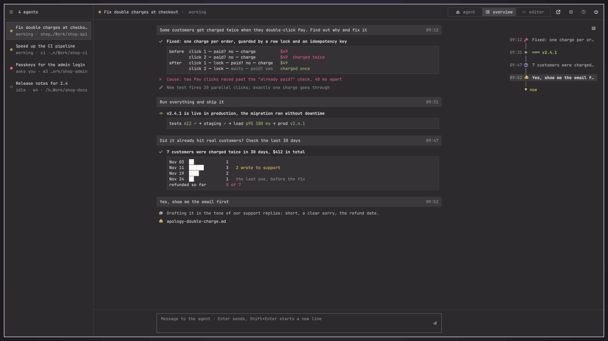
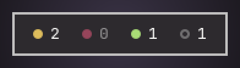
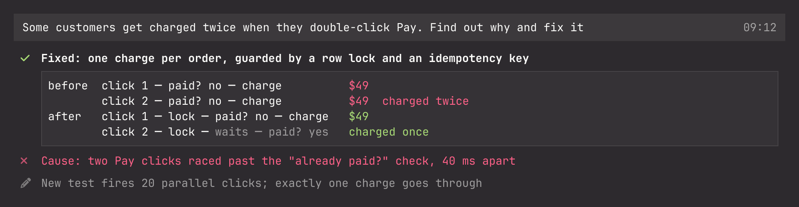
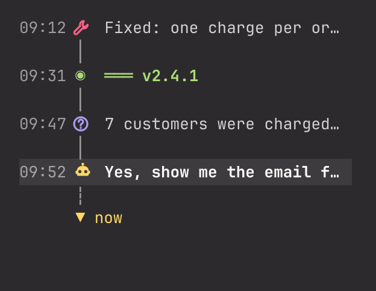

<div align="center">

# 🐑 Drover

**Your herd of AI agents, always in sight.**

A tiny live herd of your [herdr](https://herdr.dev) agents on every
[Omarchy](https://omarchy.org) workspace: who works, who's done, who needs you.

[](https://github.com/petrzpav/drover/releases/latest) [](LICENSE) [](https://omarchy.org) [](https://herdr.dev)



</div>

## Why Drover

- 🐑 **A herd on every workspace.** One pixel sheep per agent: working ones wander, done ones graze in the pen, the asking one stands under a `?`.
- 💬 **Answer where you are.** Claude's questions and permission prompts come on a small stage. Press `1`–`9`.
- 📋 **Walls of text, summed up.** Each turn becomes 1–3 points, a small drawing when it helps, and a station on a metro line.
- 🖥️ **A real terminal, one click away.** The agent's herdr pane in a panel: colors, menus, `Shift+Tab`, `Esc`, `Ctrl+C`.
- ✏️ **An editor beside every agent.** `Alt+E` opens [Fresh](https://github.com/sinelaw/fresh) in its folder.
- 🎨 **Part of Omarchy.** Theme colors, border, rounding and terminal font, following theme switches live.

## Install

```sh
sudo pacman -U https://github.com/petrzpav/drover/releases/download/v0.9.2/drover-0.9.2-1-x86_64.pkg.tar.zst
drover hooks install    # Claude's questions on drover's stage
```

It needs `herdr`; `fresh-editor` (AUR) adds the editor. From source:
`git clone https://github.com/petrzpav/drover && cd drover && bin/install`.

```lua
-- ~/.config/hypr/autostart.lua
o.launch_on_start("drover")
-- ~/.config/hypr/bindings.lua
o.bind("SUPER + H", "Herdr agents", "drover toggle")
o.bind("SUPER + ALT + H", "Herdr agents, full screen", "drover fullscreen")
```

## The herd

| `indicator` | Looks like | Shows |
| ----------- | ---------- | ----- |
| `sheep` |  | A sheep per agent: wandering (working), in the pen (done), under a `?` (asking), asleep (idle) |
| `bars` (default) |  | A bar per agent: bouncing, settling green, blinking red |
| `dots` |  | How many agents work, ask, are done and idle |

The border flashes green when an agent finishes and red when one asks, and stays red while anyone waits for you. Drag the herd anywhere; it stays there.

## Questions on the stage


- An agent's question jumps onto a card beside the herd. `1`–`9` picks an option, the last row takes your own words.
- Permission prompts: yes, yes and don't ask again, no, or no with what to do instead.
- A plain question at the end of a turn ("Shall I push it?") comes too; drover types your answer into the terminal.
- It never steals the keyboard: click it or press `Super+H`. `Esc` leaves it to the terminal.
- While the panel is open, questions wait; the agent shows as asking in the list.

<details>
<summary>How the stage hooks work</summary>

- `drover hooks install` (also `uninstall`, `status`) adds three Claude Code hooks to `~/.claude/settings.json` and keeps the rest; the old file stays as `settings.json.drover-backup`. Restart running agents, or review the change under `/hooks` in them.
- `drover hook` hands the question to drover over a local socket and waits. It stays silent, and Claude shows its own dialog, when drover isn't running, the session isn't a herdr agent (scripts, `claude -p`), you are looking at that agent, or the options carry previews or ask to approve a plan.
- While drover holds a question, herdr shows the agent as working. After `ask_hold` seconds the question goes back to the terminal. A permission prompt shows in both places at once.

</details>

## The panel


Every agent of the local herdr session on the left (drag to reorder, kept after a restart), its live terminal on the right.

| Key | Does |
| --- | ---- |
| `Super+H` | Show or hide the panel; with a question on stage, give it the keyboard |
| `Super+Alt+H` | The panel over the whole screen, and back |
| `Ctrl+Alt+B` | Switch between the terminal and the conversation in points |
| `Alt+↑` `Alt+↓` | Pick an agent |
| `Ctrl+B` | Show or hide the agent list (its button turns red when another agent asks); drover's, not Claude's |
| `Alt+E` | Switch between the agent and its editor; `Ctrl+;` there opens a shell below |
| `Ctrl+P` | Go to a running agent, or start one in a workspace; `Ctrl+O` picks a folder, `Ctrl+D` twice closes a workspace |
| `Ctrl+Shift+O` | Open the agent in herdr |
| `Shift`+drag, `Ctrl+Shift+C` `V` | Select, copy, paste |
| `F1` | All shortcuts |

Other keys, the mouse wheel and clicks go to the agent, as in herdr. drover remembers the full screen, the hidden list and the view.

## The conversation in points



`Ctrl+Alt+B` shows a Claude agent's conversation from its transcript instead of its terminal.

- **Each prompt, what came of it.** A model sums up every turn as it goes: a bold headline, then only what you must know. Older turns show just their headline; click to open.
- **Drawings.** When a picture says it faster (stages, a checklist, before and after, a small chart), the model draws one in text, colored where it matters.
- **Always in sight:** the agent's question, a command it gives you to run (with Copy), your queued messages, subagents and background commands.
- **The robot** bobs on the step the agent is at, so you see it work.
- **Send a message** from the field below: `Enter` sends, `Shift+Enter` breaks the line, `Ctrl+V` pastes a picture.



**The metro line** on the right has a station per turn: its time, headline and a category icon (fix, release, question, …). A release is an interchange `◉═══ v2.4.1`, a subagent a branch `└◇`, a failed turn `✗`, and it ends at `▼ now`. Click a station to go there.

`PgUp` `PgDn` page, `Ctrl+Home` `Ctrl+End` go to the start and end.

<details>
<summary>How summaries work</summary>

- `claude -p` with Sonnet on your Claude account, one call at a time (about 5 s and 4,000 tokens). `summary = off` turns them off; after a failure or a usage limit they rest a while.
- A summary is rewritten as the turn goes on (four more points and a minute later, or at its end), never added to, and kept in `~/.cache/drover/summaries`. Short turns get none; older ones get theirs when you scroll to them.
- Drawings are plain text, at most 10 lines of 64 characters.
- Commands in a row become one line; a failed one gets a red line, commits, pushes, releases and deploys a green one. Files edited with Edit and Write are listed; reading and searching are left out.
- Once the agent stops, the newest turn's last reply shows in full. Nothing moves under the pointer: new summaries and scrolling wait while it's over the list.
- A click on a point opens what it sums up: the agent's words as Markdown (nothing fetched), the error, every command of a run.
- Pasted pictures are saved to `~/.cache/drover/pasted` and go as their path. Messages don't go over a draft in the agent's prompt, or while it asks you something.
- When Claude parks a conversation as a background job, the overview follows it.

</details>

## Configuration

`~/.config/drover/config`, read at start:

```ini
# sheep, bars (default) or dots
indicator = sheep
# what Ctrl+P starts: claude (default), codex, …
agent = claude
# the editor beside an agent: fresh (default), micro, …
editor = fresh
# how the sheep comes on stage: fence (default) or spotlight
stage = fence
# end-of-turn questions on the stage too: yes (default) or no
ask_replies = yes
# seconds before a question goes back to the terminal; 0 waits for good
ask_hold = 180
# the model that sums up turns: sonnet (default), haiku, … or off
summary = sonnet
# close workspaces with a herdr plugin's action instead of herdr workspace close
# close_action = petrzpav.persistent-spaces.delete
```

```sh
drover               # start (autostart), or open/hide the running one
drover toggle|open   # open or hide the panel, starting drover if needed
drover fullscreen    # the panel over the whole screen, and back
drover pick          # open the panel with the workspace picker
drover quit
```

<details>
<summary>Workspace picker</summary>

- `Ctrl+P` lists running agents first, the one you were at highlighted, so `Ctrl+P` `Enter` switches back and forth. Typing narrows them by title or workspace.
- Below are the workspaces: `Enter` opens a new tab in one, in the folder it works in, and starts the default agent.
- A new name adds a **Create** row: `Enter` opens the folder picker, unless the text is a folder under your home (`~/Work/orchard`). A missing folder inside an existing one shows **new folder** and is made first.
- `Ctrl+D` or the trash button marks a workspace; a second press runs `herdr workspace close`, or `close_action`.
- Hyprland bindings that take `Ctrl+P` globally can pass it on while drover's panel has the keyboard, marked by `$XDG_RUNTIME_DIR/drover.focus`:

```lua
local focus = io.open((os.getenv("XDG_RUNTIME_DIR") or "") .. "/drover.focus")
if focus then focus:close(); hl.exec_cmd("drover pick") return end
```

</details>

<details>
<summary>How it works</summary>

- A transparent wlr-layer-shell surface (`layer-shell-qt`) on the top layer: it floats over windows on every workspace, hides under full-screen windows, and only the herd and the open panel take the pointer. It takes the keyboard only while the panel or the stage has it.
- It lists agents whenever herdr's socket reports a change, and polls every 5 s (every second without events). Only the local herdr session; saved SSH machines take seconds per call.
- The terminal is drawn by drover on libvterm (`herdr terminal attach`), with no output buffering. The pane takes the panel's size while it's open.
- The look comes from Omarchy: `colors.toml`, the Hyprland border, rounding and gaps, and your terminal's font (Ghostty, Alacritty, kitty or foot). Theme and language (English, Czech) switch live.
- drover writes a Fresh theme from the Omarchy colors to `~/.config/fresh/themes/omarchy.json`; use it with `{ "theme": "omarchy.json" }` in Fresh's `config.json`.

</details>

## Build

```sh
bin/build        # build/drover
bin/test         # Qt Test, offscreen: the backend, and the real QML against a fake herdr
bin/install      # makepkg -fsi: binary, launcher entry, icon
bin/screenshots  # redraws docs/ against a made-up herd (needs ffmpeg)
```

Needs `qt6-base`, `qt6-declarative`, `qt6-wayland`, `layer-shell-qt`, `libvterm` and `herdr`.

## License

MIT, see [LICENSE](LICENSE).
